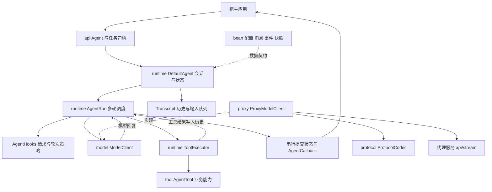
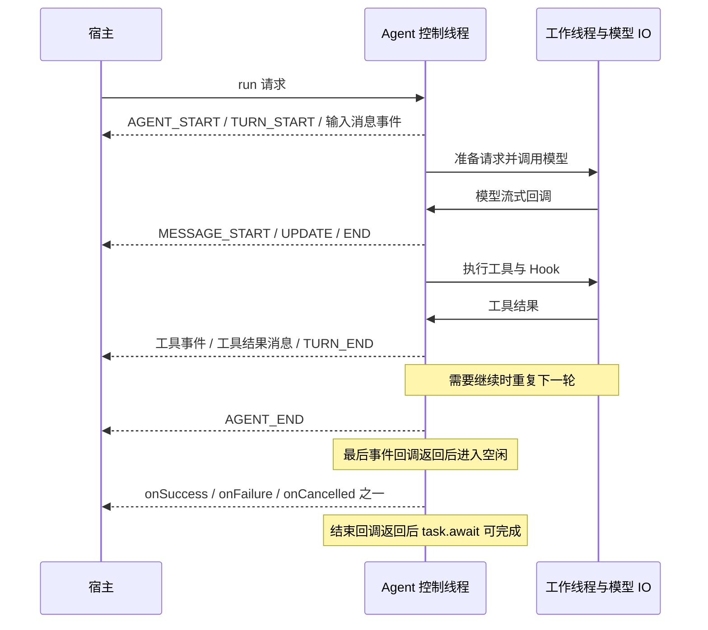

# Agent Core 接入指南

本文面向将 Agent Core 接入 Kotlin 或 Java 应用的业务研发、模型适配和工具能力提供方。接入完成后，宿主通过统一的 `Agent` 接口提交输入、接收事件、取消任务和管理会话，通过 `ModelClient` 和 `AgentTool` 提供模型及业务能力。

适用范围为当前仓库的回调式 API。旧版协程、`prompt + subscribe` 接口迁移见 [README](../README.md#旧接口迁移)。本文示例使用 JDK 21、Kotlin 2.1.21，不需要协程或响应式框架。

## 阅读导航

| 接入角色 | 建议阅读 |
| --- | --- |
| 首次使用 Core 的业务研发 | 职责边界、工程引入、最小接入、任务与会话、事件与线程 |
| 提供业务工具的研发 | 工具接入、Hook、取消与资源、联调验收 |
| 提供模型客户端或代理服务的研发 | 模型接入、代理协议、事件与线程、取消与资源 |
| 维护会话和生产运行的研发 | 配置、历史与持久化、错误处理、运行建议、常见问题 |

## 职责边界与架构

| 能力 | Core 负责 | 接入方负责 |
| --- | --- | --- |
| 任务运行 | 多轮调度、状态提交、单任务终态、迟到回调过滤 | 将任务关联到业务请求或界面，决定超时和重试策略 |
| 模型调用 | 构造请求并消费模型事件 | 提供客户端、实际模型身份、凭据和厂商协议适配 |
| 工具调用 | 参数准备与校验、执行策略、结果回填 | 实现业务操作、权限校验、幂等及外部操作补偿 |
| 会话 | 内存历史、系统及工具声明回放、输入队列 | 会话存储、用户隔离和多实例之间的路由 |
| 生命周期 | 取消传播、关闭自身资源 | 关闭注入的客户端、工具和共享线程池 |
| 事件 | 顺序提交并通知回调 | UI 线程切换、展示、日志和业务指标 |



入口见 [Agent](../src/main/kotlin/dev/agent/core/api/Agent.kt)，配置见 [AgentConfig](../src/main/kotlin/dev/agent/core/bean/AgentConfig.kt)。需要深入执行流程时，按 `DefaultAgent → AgentRun → ToolExecutor` 阅读。

## 工程引入

仓库尚未发布 Maven 坐标，可先作为 Gradle 子项目引入。以下假设源码放在宿主的 `vendor/alice-agent`。

宿主的 `settings.gradle.kts`：

```kotlin
include(":agent-core")
project(":agent-core").projectDir = file("vendor/alice-agent")
```

宿主使用模块的 `build.gradle.kts`：

```kotlin
repositories { mavenCentral() }

dependencies {
    implementation(project(":agent-core"))
    // 使用工具 Schema、JSON 参数等公开类型时直接声明此依赖。
    implementation("org.jetbrains.kotlinx:kotlinx-serialization-json:1.8.1")
}
```

保持 Kotlin 2.1.21 和 JDK 21。Core 使用 `java.net.http.HttpClient` 实现代理传输；接入其他运行平台前需自行验证兼容性。仓库验证使用 `./gradlew test`，Windows 使用 `gradlew.bat test`。

## 最小接入

以下两个示例使用固定回复，不依赖网络或凭据，用于先验证工程依赖、回调和资源释放。实际模型接入时替换 `modelClient` 并设置真实的 `model`。

### Kotlin 示例

```kotlin
import dev.agent.core.api.AgentCallbackAdapter
import dev.agent.core.api.AgentFactory
import dev.agent.core.bean.AgentConfig
import dev.agent.core.bean.AgentRequest
import dev.agent.core.bean.AgentResult
import dev.agent.core.bean.AssistantMessage
import dev.agent.core.bean.TextContent
import dev.agent.core.model.StaticModelClient
import java.util.concurrent.TimeUnit

class KotlinQuickstart {
    fun run() {
        val reply = AssistantMessage()
        reply.content = listOf(TextContent("已收到你的消息"))
        val config = AgentConfig()
        config.modelClient = StaticModelClient(reply)
        config.systemPrompt = "请使用中文回答。"

        val agent = AgentFactory().create(config)
        try {
            val task = agent.run(AgentRequest("你好"), object : AgentCallbackAdapter() {
                override fun onSuccess(result: AgentResult) {
                    println("本次新增消息数：" + result.messages.size)
                }

                override fun onFailure(error: Throwable) {
                    System.err.println(error.message)
                }
            })
            // 仅在宿主后台线程等待，不能放在 Agent 回调或 UI 线程中。
            if (!task.await(30, TimeUnit.SECONDS)) {
                task.cancel()
                check(task.await(5, TimeUnit.SECONDS)) { "取消仍在处理中" }
            }
        } finally {
            agent.close()
        }
    }
}
```

`await` 返回 `true` 只表示任务结束且结束回调已经返回，不能据此判断成功；业务结果以结束回调或 `getStatus()` 为准。`await` 超时不会自动取消任务。

### Java 示例

```java
import dev.agent.core.api.Agent;
import dev.agent.core.api.AgentCallbackAdapter;
import dev.agent.core.api.AgentFactory;
import dev.agent.core.api.AgentTask;
import dev.agent.core.bean.AgentConfig;
import dev.agent.core.bean.AgentRequest;
import dev.agent.core.bean.AgentResult;
import dev.agent.core.bean.AssistantMessage;
import dev.agent.core.bean.TextContent;
import dev.agent.core.model.StaticModelClient;
import java.util.List;
import java.util.concurrent.TimeUnit;

public class JavaQuickstart {
    public static void main(String[] args) throws InterruptedException {
        AssistantMessage reply = new AssistantMessage();
        reply.setContent(List.of(new TextContent("已收到你的消息")));
        AgentConfig config = new AgentConfig();
        config.setModelClient(new StaticModelClient(reply));
        config.setSystemPrompt("请使用中文回答。");

        try (Agent agent = new AgentFactory().create(config)) {
            AgentTask task = agent.run(new AgentRequest("你好"), new AgentCallbackAdapter() {
                @Override
                public void onSuccess(AgentResult result) {
                    System.out.println("本次新增消息数：" + result.getMessages().size());
                }

                @Override
                public void onFailure(Throwable error) {
                    System.err.println(error.getMessage());
                }
            });
            if (!task.await(30, TimeUnit.SECONDS)) {
                task.cancel();
                if (!task.await(5, TimeUnit.SECONDS)) {
                    throw new IllegalStateException("取消仍在处理中");
                }
            }
        }
    }
}
```

`AgentFactory.create` 是实例方法，Java 和 Kotlin 都应先构造 `AgentFactory`。

## 配置说明

配置在创建和 `updateConfig` 时复制。修改原配置不会直接改变运行中的 Agent。

| 属性 | 默认值 | 接入约定 |
| --- | --- | --- |
| `modelClient` | `null` | 必填，保留客户端引用；Core 不负责关闭 |
| `model` | `Model()` | 固定回复示例以外，应设置真实 `id`、`provider`、`api` 等信息；Core 不做模型发现 |
| `thinkingLevel` | `OFF` | 每轮设置请求 reasoning，覆盖 `streamOptions.reasoning`；OFF 不附加 reasoning 请求 |
| `systemPrompt` | `null` | 初始化或恢复历史缺少首条系统消息时用于构建基线；更新配置不改写现有对话 |
| `tools` | 空列表 | 工具名须非空白且唯一；声明复制，工具实现保留引用 |
| `messages` | 空列表 | 仅创建时作为初始历史；`updateConfig` 忽略此字段 |
| `streamOptions` | `StreamOptions()` | 模型参数与 Provider Hook；实际支持范围由适配器决定；signal 被当前任务令牌替换 |
| `hooks` | `AgentHooks()` | 默认策略，保留引用，在工作线程调用 |
| `toolExecution` | `PARALLEL` | 全局串行或任一工具要求串行时，整批串行 |
| `steeringMode` | `ONE_AT_A_TIME` | 优先队列每次取一条；ALL 取当前队列全部消息 |
| `followUpMode` | `ONE_AT_A_TIME` | 后续队列每次取一条；ALL 取当前队列全部消息 |
| `workerExecutor` | `null` | 默认创建 8 个工作线程；可注入宿主线程池，创建后不能更换 |

默认线程数描述的是当前实现，不代表吞吐承诺。`updateConfig` 只允许空闲时调用，并保留历史和排队输入；更换工作线程池需要创建新的 Agent。

## 任务与会话

一次任务可以包含多轮模型调用。模型产生工具调用后，Core 执行工具，把结果写入历史，再请求模型，直到满足结束条件。

| 方法 | 行为 | 调用条件 |
| --- | --- | --- |
| `run(request, callback)` | 提交新消息并开始任务，立即返回句柄 | 未关闭且空闲 |
| `continueRun(callback)` | 基于历史继续，不额外提交请求消息 | 未关闭且空闲；存在非系统历史；助手结尾时还需排队输入 |
| `steer(message)` | 复制后排入优先队列，不自动启动任务 | 未关闭，可运行中调用 |
| `followUp(message)` | 复制后排入后续队列，不自动启动任务 | 未关闭，可运行中调用 |
| `getState()` | 获取独立状态快照 | 可运行中调用 |
| `restoreHistory(messages)` | 恢复历史副本并清队列、补系统基线 | 未关闭且空闲 |
| `reset()` | 清对话和队列，保留当前系统基线及配置 | 未关闭且空闲 |
| `clearSteeringQueue()` / `clearFollowUpQueue()` | 清指定队列 | 可运行中调用 |
| `clearAllQueues()` | 依次清两类队列，不是跨队列原子操作 | 可运行中调用 |
| `hasQueuedMessages()` | 查看是否还有未选取的输入 | 查询不会预留输入 |
| `peekQueuedMessages()` | 按消费策略预览优先队列，若为空则预览后续队列 | 返回副本，不是两类队列的完整合并列表 |

同一 Agent 只允许一个活动任务；并发 `run` 会抛 `IllegalStateException`。将一个 Agent 绑定到一个逻辑会话，由宿主维护用户、会话和实例的映射。

`steer` 在当前工具批次完成后的调度阶段优先处理，不中断正在执行的工具。`followUp` 在工具续跑和优先输入都无需继续时消费。Hook 强制结束、失败或取消不保证消费排队消息。

队列消息在写入历史后才确认消费；准备阶段失败或取消时，未提交部分会按原顺序回队。清队列不撤销已选入准备阶段的消息，但会阻止这些消息以后回队。

## 事件与线程

### 回调时序

普通成功任务的典型顺序如下。消息事件会因输入、系统声明、模型回复和工具结果多次出现；没有流式增量时不产生 `MESSAGE_UPDATE`。



| 事件 | 主要字段与用途 |
| --- | --- |
| `AGENT_START` | 本次任务开始 |
| `TURN_START` | 新一轮开始 |
| `MESSAGE_START` | `message`，开始处理一条消息 |
| `MESSAGE_UPDATE` | `message` 为当前快照，`assistantMessageEvent` 为模型增量信息 |
| `MESSAGE_END` | `message`，完成并提交一条消息 |
| `TOOL_EXECUTION_START` | `toolCallId`、`toolName`、`args`；表示进入工具处理流程，可能随后被校验或权限拦截 |
| `TOOL_EXECUTION_UPDATE` | `partialResult`，工具进度 |
| `TOOL_EXECUTION_END` | `result`、`isError`、`durationMs` 等工具结果信息 |
| `TURN_END` | 本轮助手 `message` 和 `toolResults` |
| `AGENT_END` | 最后事件，`messages` 为本次新增消息 |

`AgentResult.messages` 也仅包含本次新增消息，通常包括输入、系统更新、助手和工具结果。完整会话应读 `getState().messages`，不要把新增消息误当成完整历史。字段以 [AgentEvent](../src/main/kotlin/dev/agent/core/bean/AgentEvent.kt) 为准。

### 线程约定

宿主 `AgentCallback` 在 Agent 控制线程串行执行，先提交状态再通知事件。最后事件回调返回后，Agent 进入空闲，再调用且仅调用一种结束回调；结束回调可以发起下一次任务。

模型调用、工具执行和运行 Hook 使用工作线程；适配器可从自己的 IO 线程回调，Core 将其串行提交。`ModelCallback.onEvent` 同步返回是流量控制边界，生产方应等待返回后再继续，不要用无界队列转发增量。

控制调度器的外部队列容量为 128，队列满时生产者等待消费。慢 `AgentCallback` 会拖慢流式消费和任务推进；回调中只做轻量处理，UI 更新应切换到宿主 UI 线程。禁止在回调中等待当前任务或同一 Agent 的下一任务结束。

宿主回调异常会被隔离并记录，不会改变已确定的任务结果；模型和工具适配器仍须保证自身每条路径完成通知，不能依赖异常隔离来补齐缺失回调。

## 模型接入

### 接口契约

实现 [ModelClient](../src/main/kotlin/dev/agent/core/model/ModelClient.kt) 的 `stream(ModelRequest, ModelCallback): Cancellable`。请求包含模型信息、已转换的上下文和本轮选项。

1. 流式回复先发送 `start`，通过 `partial` 提供初始助手消息，停止原因为 `PENDING`。
2. 文本、思考内容和工具参数增量必须携带当前累积的 `partial` 快照；只传 `delta` 不足以更新 Core 的消息状态。
3. 正常结束发送 `type = "done"`；模型错误发送 `type = "error"`。终止事件应通过 `message` 提供完整最终助手消息，并设置该消息的 `stopReason`。Core 也兼容终止事件用 `partial` 承载最终消息。
4. 终止事件之后调用 `onComplete()`；传输或适配失败可调用 `onFailure(Throwable)`。直接 `onComplete()` 而没有终止事件会被判为协议错误。
5. 回调顺序串行；`onEvent` 返回前不能修改正在传递的快照，也不能持业务锁等待回调。返回的句柄必须能取消底层 IO；同步实现也应检查请求的取消令牌。

无流式能力时，可参考 [StaticModelClient](../src/main/kotlin/dev/agent/core/model/StaticModelClient.kt) 的 start 和 done/error 包装方式。它只返回预设回复，不会代替宿主调用实际模型服务。

工具请求应以 `ToolCall` 内容块出现在最终助手消息中，包含调用 ID、工具名和完整参数。`ERROR` 和 `ABORTED` 不执行工具；`LENGTH` 表示输出截断，Core 也不会执行其中的工具调用，而会产生模型可见的错误工具结果。

Core 会过滤重复终止和过期模型回调，适配器仍应在自己的生命周期内保证单次结束，及时释放连接。

### 使用内置代理客户端

`ProxyModelClient` 实现本项目的 JSON/SSE 协议，不能直接替代任意模型厂商的 SDK。以下为装配片段，`baseUrl`、`tokenProvider` 和 `actualModel` 由宿主提供：

```kotlin
val proxy = ProxyModelClient(baseUrl, tokenProvider)
val config = AgentConfig()
config.modelClient = proxy
config.model = actualModel
val agent = AgentFactory().create(config)
```

其中 `tokenProvider` 实现 `dev.agent.core.proxy.AuthTokenProvider` 的 `getToken(): String`，`actualModel` 类型为 `dev.agent.core.bean.Model`。退出时先关闭使用此客户端的 Agent，完成必要的任务收尾后再关闭 `proxy`；共享客户端只在所有使用方不再需要时关闭。

### 代理协议

| 项目 | 约定 |
| --- | --- |
| 请求地址 | 根地址去除尾部 `/` 后追加 `/api/stream`；根地址不带认证、query 或该路径 |
| 请求方法 | `POST`，`Content-Type: application/json` |
| 认证 | 每次请求在 IO 线程调用 `getToken()`，发送 `Authorization: Bearer <token>` |
| 请求体 | `model`、`context`、`options`；具体编码见 `ProtocolCodec` |
| 响应读取 | 逐行读取 `data:` 后的单行 JSON；空 data 行及非 data 行忽略，不拼接多行 data |
| 结束条件 | 收到 `done` 或 `error` 立即停止读取，不等待服务端断开连接 |
| 异常 | HTTP 非 2xx、解析错误、没有终止事件的 EOF 转为 error 模型事件 |
| 取消 | 关闭响应体并取消 HTTP 请求，通过 `onFailure(CancellationException)` 通知 |

最小文本响应的 SSE 数据如下，事件分隔用空行，JSON 本身保持单行：

```text
data: {"type":"start"}

data: {"type":"text_start","contentIndex":0}

data: {"type":"text_delta","contentIndex":0,"delta":"你好"}

data: {"type":"text_end","contentIndex":0}

data: {"type":"done","reason":"stop"}

```

代理按 `contentIndex` 合并内容。还支持 `thinking_start/delta/end`、`toolcall_start/delta/end`；工具开始事件使用 `id` 和 `toolName`，结束事件用 `toolCall` 提供完整调用。文本和思考结束事件可带 `contentSignature`；终止事件可带 `usage`、`errorMessage`、`providerThinkingLevel`。`reason` 支持 `StopReason.wire` 定义的值，未知值会导致解析失败。

`options` JSON 使用白名单编码，包括温度、采样参数、最大输出、reasoning、缓存、会话、headers、metadata、transport、thinkingBudgets、maxRetryDelayMs。Provider API key、取消令牌、Hook 和 identity 不通过该编码器写入 options JSON。`headers` 是请求体内交给代理处理的字段，不会直接加到这次代理 HTTP 请求头上。`maxRetryDelayMs` 只是传递参数，客户端本身不因此自动重试。

Provider Hook 通过 `StreamOptions` 配置：`onPayload` 可替换请求体，`onResponse` 观察 HTTP 状态和响应头，`onProviderStreamEvent` 观察原始 JSON 事件。自定义 `onPayload` 时，接入方负责维持协议和凭据边界。

## 工具接入

工具实现 `AgentTool`，或继承提供默认参数准备逻辑的 `AbstractAgentTool`。下面是一个同步、无外部 IO 的完整工具示例，注册时将 `EchoTool()` 加入 `config.tools`。

```kotlin
import dev.agent.core.api.Cancellable
import dev.agent.core.api.NoOpCancellable
import dev.agent.core.bean.AgentToolResult
import dev.agent.core.bean.TextContent
import dev.agent.core.bean.ToolContext
import dev.agent.core.bean.ToolDefinition
import dev.agent.core.tool.AgentTool
import dev.agent.core.tool.ToolCallback
import kotlinx.serialization.json.Json
import kotlinx.serialization.json.JsonElement
import kotlinx.serialization.json.jsonObject
import kotlinx.serialization.json.jsonPrimitive

class EchoTool : AgentTool {
    override fun getDefinition(): ToolDefinition {
        val definition = ToolDefinition()
        definition.name = "echo"
        definition.description = "返回输入文本"
        definition.parameters = Json.parseToJsonElement(
            """{"type":"object","properties":{"text":{"type":"string"}},"required":["text"],"additionalProperties":false}"""
        ).jsonObject
        return definition
    }

    override fun prepareArguments(arguments: JsonElement): JsonElement = arguments

    override fun execute(context: ToolContext, callback: ToolCallback): Cancellable {
        context.signal?.throwIfCancelled()
        val text = context.arguments.jsonObject.getValue("text").jsonPrimitive.content
        val result = AgentToolResult()
        result.content = listOf(TextContent(text))
        callback.onSuccess(result)
        return NoOpCancellable()
    }
}
```

### 声明与结果

| 字段 | 约定 |
| --- | --- |
| `ToolDefinition.name` / `description` | 模型可见名称和能力描述；名称在配置内唯一 |
| `parameters` | 输入 JSON Schema，Core 在执行前验证；参数准备先于验证 |
| `executionMode` | 设为 SEQUENTIAL 会使同批全部工具串行 |
| `outputSchema` | 输出约定元数据，Core 不主动验证，也不通过当前 ToolDeclaration 发送给模型 |
| `AgentToolResult.content` | 模型可读的结果正文，可包含多个内容块 |
| `structuredContent` / `details` | 结构化结果及详情；由宿主决定业务使用方式 |
| `isError` | 工具失败标记，普通工具失败仍可交给模型处理 |
| `terminate` | 只有同批所有结果均为 true 才停止自动工具续跑；仍可能处理排队输入或 Hook 的继续决策 |

### 执行与失败约定

每个工具调用遵循：参数准备 → Schema 验证 → `beforeToolCall` → 执行 → `afterToolCall`。并行模式先按模型顺序完成整批 preflight，再执行工具；串行模式依次准备并执行各调用。并行完成事件按实际完成顺序发送，历史工具结果按模型调用顺序提交。

未知工具、参数校验失败、权限拦截和普通工具异常形成错误工具结果，不直接等同于任务失败。工具可以用 `onProgress` 报告进度，最终调用一次 `onSuccess` 或 `onFailure`。重复结束和结束后的进度会被 Core 忽略。

异步工具返回实际可取消句柄；长期 IO 应同时响应 `ToolContext.signal`，必要时通过 `addListener` 关闭连接，在操作结束时取消监听注册。`NoOpCancellable` 只适用于已经同步完成或无需撤销的工作，不适合未完成的网络请求。

有外部副作用的操作由接入方使用 `toolCallId` 或业务请求号落实幂等。取消不撤销已经成功发送的请求或已经完成的操作。

## Hook 接入

继承 `runtime.AgentHooks` 并设置 `config.hooks`。Hook 在工作线程调用，收到的上下文为副本；长期阻塞工作应检查取消令牌。共享 Hook 实例可能被多个 Agent 同时使用，需要由实现保证线程安全。

| 方法 | 用途与时机 |
| --- | --- |
| `prepareRequest` | 包括首轮在内，每次模型请求前调整上下文、模型和推理级别 |
| `transformContext` | 在模型消息转换前裁剪上下文或注入检索信息 |
| `convertToLlm` | 转换业务消息；默认只保留系统、用户、助手、工具结果四种内置消息 |
| `getApiKey` | 按 provider 动态取得模型凭据，由实际适配器使用 |
| `beforeToolCall` | 验证后做权限检查；返回 block 决策，或修改 `context.args` 替换为可信参数 |
| `afterToolCall` | 替换结果内容、结构化结果、错误状态及 terminate 标记 |
| `finishTurn` | 工具结果提交后决策；null 使用自然调度，END 强制结束，CONTINUE 在自然停止点继续 |
| `prepareNextTurn` | 已决定继续后，替换上下文或追加下一轮消息 |

请求准备顺序为 `prepareRequest → transformContext → convertToLlm → getApiKey → 模型调用`。`AgentLoopTurnUpdate.context` 是整体上下文替换，不是字段合并；`model` 和 `thinkingLevel` 只影响当前任务。追加消息使用 `prepareNextTurn` 返回的 `messages`；当前 `prepareRequest` 不消费返回值的 `messages` 字段。

`beforeToolCall` 替换参数后不重复验证，替换值必须由 Hook 自己保证可信有效。`afterToolCall` 只替换正文而不提供新结构化输出时，会清除旧结构化输出。模型 ERROR/ABORTED 优先结束任务，不会被 CONTINUE 改成继续。

不要让 CONTINUE 无条件重复。Core 没有统一的最大轮数或整任务超时配置；宿主可在 `finishTurn` 中按轮数、费用等条件结束，并用外部超时机制取消任务。

## 历史与持久化

业务侧保存 `agent.getState().messages`，下次创建时放入 `AgentConfig.messages`，或空闲时调用 `restoreHistory`。需要 JSON 存储时使用 [ProtocolCodec](../src/main/kotlin/dev/agent/core/protocol/ProtocolCodec.kt) 的 `message` 和 `decodeMessage`，逐条转换；存储介质和会话版本由宿主管理。

历史不只是聊天文本。`SystemMessage.sections` 支持 section 更新和删除，`toolsAdded/toolsRemoved` 记录工具声明变更，`Transcript` 根据历史回放当前系统和工具声明。保留消息顺序、签名、未知厂商元数据及工具调用 ID，避免把历史简化成 role/text 后再回传。

自定义 `AgentMessage` 或 `ContentBlock` 必须实现 `snapshot()`，深复制自身可变数据，且不能递归调用自身。自定义业务消息通过 `convertToLlm` 转成支持的模型消息；`ProtocolCodec` 不会自动编码任意自定义类型，持久化这类消息需要宿主自定义协议。

Core 复制输入配置、历史、事件、工具结果和状态快照；修改返回 Bean 不会改变 Agent。客户端、工具、Hook、线程池作为资源或策略保留引用，因此其内部可变状态仍由接入方保护。

## 取消与资源管理

`AgentTask.cancel()` 发出取消请求，传播到模型、工具及 IO；它不是阻塞式等待。用带超时的 `await` 确认任务结束，不能在任务自己的回调中等待。成功、失败、取消只选一种终态；进入最后事件阶段后，迟到取消不改写已经确定的结果。

`Agent.close()` 幂等，拒绝后续任务和入队，请求取消活动任务。它不等待所有业务回调返回，活动任务收尾后释放自有线程资源。同步 Hook 或工具若忽略取消和中断，其外部操作仍可能继续，接入方必须为这些操作设置自己的 IO 超时。

| 资源 | 创建与关闭责任 |
| --- | --- |
| Agent 控制线程 | Core 创建和关闭 |
| 默认 Agent 工作线程池 | Core 创建和关闭 |
| 注入的 `workerExecutor` | 宿主创建和关闭；先结束使用它的 Agent |
| 模型客户端和工具 | 宿主管理，Agent 不调用其 close |
| ProxyModelClient 默认 IO 池及 HTTP 客户端 | ProxyModelClient 创建，由它的 close 关闭 |
| ProxyModelClient 注入的 IO 池 | 宿主关闭，proxy.close 不关闭此池 |

`ProxyModelClient` 默认有 4 个 IO 线程和容量为 64 的等待队列。调度拒绝或启动前取消会在调用线程通知模型失败，不能假设所有 `ModelCallback` 都来自同一条 IO 线程；宿主的 `AgentCallback` 仍由 Core 控制线程串行通知。

## 错误处理与运行建议

| 情况 | 对接方会看到什么 | 处理建议 |
| --- | --- | --- |
| 配置缺失、工具名冲突、更新工作线程池 | 创建或更新时同步抛 `IllegalArgumentException` | 启动时校验配置 |
| Agent 忙或已关闭时发起任务 | 同步抛 `IllegalStateException`，不是异步 onFailure | 通过宿主串行请求或输入队列协调 |
| 模型/传输失败、协议不完整 | 任务 onFailure；历史可能已有部分消息或错误助手消息 | 展示失败，保存已提交历史；评估后再续跑 |
| 普通工具失败 | 错误工具结果，模型可能继续且任务可能成功 | 业务成功不能仅依赖任务 SUCCEEDED |
| 宿主回调抛异常 | Core 隔离并记录 | 在宿主回调内自行处理业务异常 |
| 自定义快照失败 | 任务失败并清理；最后事件仅保留可复制的消息 | 检查 snapshot 实现 |
| 任务取消 | onCancelled，一次终态 | 检查外部操作状态，避免盲目重放 |

对有副作用的任务，不要对整个 `run` 做无条件自动重试。先确认已提交历史、工具执行状态和业务幂等规则，再决定恢复或重试。

为每次调用记录业务请求号、宿主会话号、任务 `getId()`、工具调用 ID、任务终态和耗时。模型 usage 可从助手消息获取；费用口径由宿主统一计算。凭据、认证头和含敏感信息的完整上下文不应直接写入日志。

宿主自行确定 Agent 数量、线程池容量、输入队列上限和限流规则。Core 控制事件队列有背压，但 `steer/followUp` 输入队列未提供容量上限；不要把它当作无限业务消息缓冲。`StreamOptions.maxTokens` 仅约束模型单轮输出，不是整任务预算。

## 联调验收

交付业务接入前，至少覆盖以下场景。异步验证使用可控回调或 CountDownLatch 等同步工具，所有等待设置超时。

- 固定回复及真实模型各跑通一次；确认 Kotlin 或 Java 的配置、回调和关闭逻辑。
- 模型流式文本、工具参数、done/error 均能正确处理；缺少终止事件时任务能够失败结束。
- 工具正常返回、参数不合法、未知工具、权限拦截和外部 IO 失败均有明确结果。
- 并行工具按完成顺序通知、按调用顺序记历史；任一工具串行时整批串行。
- 运行中额外 run 被拒绝；steer、followUp 优先级和自然结束行为符合业务预期。
- 模型 IO、工具 IO、准备 Hook 阶段取消后任务只结束一次，迟到回调不修改终态。
- 输出截断不执行工具；混合 terminate 结果继续，全部 terminate 才停止自动工具续跑。
- 历史保存及恢复保留系统 section、工具声明、签名和扩展字段。
- 修改输入对象及 getState 返回对象不影响运行；回调抛异常不导致任务挂起。
- 关闭 Agent 不关闭共享线程池；代理客户端和宿主资源均能按各自生命周期释放。

仓库测试参考：循环与工具行为见 [LoopTest](../src/test/kotlin/dev/agent/core/LoopTest.kt)，生命周期见 [AgentLifecycleTest](../src/test/kotlin/dev/agent/core/AgentLifecycleTest.kt)，代理见 [ProxyTest](../src/test/kotlin/dev/agent/core/ProxyTest.kt)，协议与快照见 [ProtocolContractTest](../src/test/kotlin/dev/agent/core/ProtocolContractTest.kt)。

## 常见问题

**为什么 run 返回后还没有结果？** 它返回的是任务句柄，结果从回调到达。不要在 UI 线程等待。

**为什么在 onEvent 中读取状态已经变化？** Core 先提交状态，再通知该事件，这是接口保证。

**为什么工具调用失败，任务却成功？** 普通工具错误是模型可见结果，模型可能解释错误后正常结束。任务成功表示运行成功完成，业务成功需要按工具结果或业务条件判断。

**为什么 followUp 没立刻执行？** 它在自然停止点消费；需要优先改变下一轮方向时使用 steer，两者都不会打断当前工具批次。

**为什么更新 systemPrompt 没改变当前会话？** updateConfig 保留历史。需要替换当前历史时使用 restoreHistory，或通过系统消息更新对应 section。

**为什么 peekQueuedMessages 没返回所有排队消息？** 它按优先级和 QueueMode 预览一批候选输入，不合并两个队列。

**为什么改了 streamOptions.reasoning 没生效？** 实际值由 AgentConfig.thinkingLevel 或准备 Hook 决定。

**为什么取消后外部操作仍然发生？** 取消是尽力传播，不能撤销已发生的操作；业务工具必须响应取消并实现幂等或补偿。

**为什么 close 后线程池还在？** 宿主注入的线程池不由 Core 关闭；模型客户端和工具也需要宿主单独释放。

**可以直接传厂商 API 地址给 ProxyModelClient 吗？** 只有服务实现本文的 `/api/stream` 协议才可以，否则应自行实现 ModelClient。
